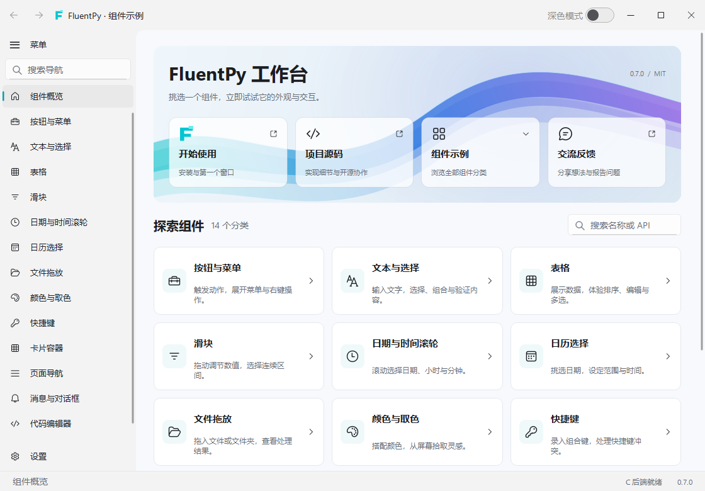

<picture>
  <source media="(prefers-color-scheme: dark)" srcset="assets/header-dark.svg">
  
</picture>

# 👋 嗨，我是 xddxmt！

一个正在努力升级中的**初中生程序员** :D

欢迎来到我的 GitHub！这里是我写代码、做项目、记录想法的小基地。主要折腾 **Python 和 Web**，也在探索 **Qt 桌面界面、C 扩展和加密通信**。

想把脑子里的点子，慢慢做成真正能用的东西。还在学习，也一直在动手 🛠️

## 🚀 我的代表作

### 🪟 FluentPy

**给 Python 桌面应用添一点 Fluent 风格。**

这是我独立开发的 Qt for Python 组件库，采用 MIT 许可证。从按钮、输入框、卡片，到表格、导航和消息提示，可以逐个使用，也能组合成完整的桌面界面。

主题切换、界面动画和可交互的示例工作台也都安排上了。下面就是工作台的实际样子 👇

<a href="https://github.com/XDDXMT/FluentPy">
  <picture>
    <source media="(prefers-color-scheme: dark)" srcset="assets/fluentpy-workbench-dark.png">
    
  </picture>
</a>

界面和动画交给 Qt，部分计算由 C 扩展加速；没有扩展时，也能使用 Python 兼容实现。已经发布到 PyPI，可以这样安装：

```console
python -m pip install fluentpy-qt
```

📦 [源码与示例](https://github.com/XDDXMT/FluentPy) · 📖 [中文文档](https://fluentpy.mcxmcl.cn/) · [PyPI](https://pypi.org/project/fluentpy-qt/) · 🖥️ [工作台下载](https://github.com/XDDXMT/FluentPy/releases)

### 🗂️ 馒云盘

**一个想让文件分享更省心的云盘。**

分享内容无需登录就能访问，上传、下载不限速，也希望把存储成本做得更亲民。对，就是我自己做的！

☁️ [去馒云盘看看](https://man.mcxmcl.cn)

### 🔐 Sovereign-Chain · 天启御链

**研究一下，怎样把“悄悄话”好好传过去。**

这是一个基于 TCP 的加密通信项目，支持证书认证、消息加密和中转代理。我用它探索握手流程、身份验证与传输效率，也记录实现过程中的思考。

🔗 [查看源码](https://github.com/XDDXMT/Sovereign-Chain)

## 🧰 我在折腾什么

| 方向 | 正在做的事 |
| --- | --- |
| 🐍 Python | 写应用、做工具，把重复的事情交给代码 |
| 🌐 Web | 前端界面、后端服务，都想多学一点 |
| 🪟 Qt / PySide6 | 做桌面组件，打磨主题、动画与交互 |
| ⚙️ C 扩展 | 给 Python 项目的部分计算加速 |
| 🔐 网络通信 | 探索加密协议、身份验证与中转机制 |

## 👥 一起做点东西

目前带领 **XMCL** 和 **XRSL** 两个团队，和伙伴们一起推进项目。一个人的点子，也可以变成一群人一起做的东西。

🏠 [XMCL 团队](https://www.mcxmcl.cn) · 🌐 [XRSL 团队](https://web.mcxmcl.cn)

## 📊 我的 GitHub 小记录


## 📫 来找我聊聊

项目使用、问题反馈、开发合作，或者单纯交流技术，都欢迎！

- 邮箱：[xddxmt@mcxmcl.cn](mailto:xddxmt@mcxmcl.cn)
- QQ：**3242247564**

具体项目的问题也可以直接提 Issue，方便一起跟进。

## ❤️ 支持一下我的项目

如果这些项目刚好帮到了你，一个 Star、一条建议或一次贡献，都是继续写下去的动力。

也可以通过[爱发电](https://afdian.com/a/xddxmt)支持后续开发。谢谢愿意关注这些小项目的你！
